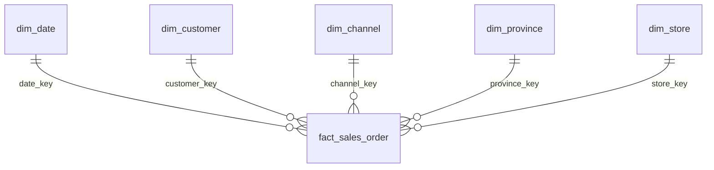

# EcoBottle AR — Data Warehouse y dashboard comercial

**Trabajo práctico | Introducción al Marketing Online y los Negocios Digitales**

Proyecto de inteligencia comercial para **EcoBottle AR**, una empresa ficticia que comercializa las botellas reutilizables *Classic A Bottle* y *Sport B Bottle* a través de un canal online y tiendas físicas. A partir de 13 archivos CSV originales, construimos un **Data Warehouse dimensional con enfoque Kimball** en DuckDB, definimos seis indicadores de negocio en SQL y publicamos un dashboard interactivo mediante **GitHub Pages**.

### [🌐 Abrir el dashboard interactivo](https://lucagiu204.github.io/practica-imond/)

**El dashboard puede consultarse directamente desde el navegador.** No es necesario ejecutar Python, instalar DuckDB ni descargar el repositorio para visualizarlo.

Enlaces del proyecto:

- [Repositorio de este trabajo](https://github.com/LucaGiu204/practica-imond)
- [Consigna del trabajo práctico](https://docs.google.com/document/d/15RNP3FVqLjO4jzh80AAkK6mUR5DOLqPxLjQxqvdzrYg/edit?usp=sharing)
- [Repositorio base proporcionado por el profesor](https://github.com/AugustoCarmona/practica-imond)
- [Diagrama generado del modelo estrella](./dw/modelo_estrella.md)
- [DER de los datos originales](./assets/DER.png)

**Estado del proyecto:** implementados el modelo dimensional (**seis dimensiones y seis hechos**), las consultas de los seis indicadores, **cinco Data Marts de detalle y cuatro Data Marts de KPIs precalculados**, y el dashboard web. La construcción del DW y la exportación de resultados son reproducibles mediante `run_sql.py`. Los CSV generados que necesita GitHub Pages están versionados en el repositorio.

## 1. Arquitectura de la solución

La arquitectura separa **origen, transformación, modelo dimensional, Data Marts, indicadores materializados y presentación**. El navegador no consulta `raw/` ni ejecuta consultas SQL: únicamente lee los CSV publicados con resultados calculados en DuckDB.

```text
13 CSV originales (raw/)
          |
          v
     run_sql.py + DuckDB
          |
          +--> sql/01_dimensiones.sql  --> 6 dimensiones
          |
          +--> sql/02_hechos.sql       --> 6 tablas de hechos
          |
          +--> sql/03_consultas.sql    --> 6 KPIs de referencia
          |
          v
     Data Warehouse dimensional
          |
          +--> sql/04_marts.sql        --> 5 Data Marts originales
          |                              (pedidos, NPS, sesiones,
          |                               detalle y ranking)
          |
          +--> sql/05_Marts_KPIs.sql   --> 4 Data Marts agregadas
          |                              (ventas/ticket, NPS,
          |                               usuarios, ranking filtrado)
          |
          v
     warehouse.duckdb (local y regenerable)
          |
          +--> dw/*.csv                --> dimensiones, hechos y 9 Mart
          +--> dw/modelo_estrella.md   --> diagrama generado
          +--> docs/data/*.csv         --> copias de las 9 Mart
                                               |
                                               v
                                     GitHub Pages (/docs)
                                     HTML + CSS + JavaScript
                                     (consume solo 4 CSV de KPIs)
```

### Decisiones de diseño

- **RAW:** los 13 CSV originales permanecen sin modificaciones en `raw/`. `run_sql.py` los registra como vistas `raw.nombre_tabla` para construir el DW.
- **Modelo dimensional:** seis dimensiones (producto, canal, cliente, fecha, provincia y tienda) y seis tablas de hechos. Las relaciones se describen en el [modelo estrella generado](./dw/modelo_estrella.md).
- **Reglas de negocio:** se definen en SQL. Para ventas se consideran únicamente los pedidos con estado `PAID` o `FULFILLED`.
- **Data Marts originales:** `04_marts.sql` materializa cinco conjuntos de datos basados en hechos y dimensiones del DW, sin consultar RAW directamente.
- **Data Marts de KPIs:** `05_Marts_KPIs.sql` reutiliza las Mart originales y genera **cuatro tablas agregadas** con resultados listos para consumir, incluidas las combinaciones de filtros compatibles.
- **Publicación:** `run_sql.py` exporta todas las tablas a `dw/` y copia las **nueve Mart** a `docs/data/`. El dashboard utiliza exclusivamente los cuatro CSV `mart_kpi_*.csv`.
- **Presentación:** `docs/app.js` descarga los CSV mediante `fetch()`, selecciona filas según los filtros y dibuja los gráficos. **No realiza sumas, promedios, conteos distintos ni rankings de negocio.** Los cálculos de escalas, coordenadas y anchos de barras son únicamente de presentación.
- **Funcionamiento estático:** GitHub Pages publica archivos HTML, CSS, JavaScript y CSV; no necesita un servidor DuckDB funcionando en producción.

### Estructura del repositorio

```text
practica-imond/
├── raw/                              # 13 CSV originales
├── sql/
│   ├── 01_dimensiones.sql            # 6 dimensiones
│   ├── 02_hechos.sql                 # 6 hechos
│   ├── 03_consultas.sql              # KPIs y comprobaciones SQL
│   ├── 04_marts.sql                  # 5 Data Marts originales
│   └── 05_Marts_KPIs.sql             # 4 Data Marts de KPIs
├── dw/
│   ├── dim_*.csv                     # Dimensiones exportadas
│   ├── fact_*.csv                    # Hechos exportados
│   ├── mart_*.csv                    # 9 Data Marts exportadas
│   └── modelo_estrella.md            # Diagrama autogenerado
├── docs/
│   ├── index.html                    # Estructura del dashboard
│   ├── styles.css                    # Diseño responsive
│   ├── app.js                        # Filtros y visualizaciones
│   └── data/
│       ├── mart_ventas.csv
│       ├── mart_nps.csv
│       ├── mart_actividad_web.csv
│       ├── mart_detalle_productos.csv
│       ├── mart_ranking_productos.csv
│       ├── mart_kpi_ventas.csv       # Consumido por el navegador
│       ├── mart_kpi_nps.csv          # Consumido por el navegador
│       ├── mart_kpi_usuarios.csv     # Consumido por el navegador
│       └── mart_kpi_ranking.csv      # Consumido por el navegador
├── assets/                           # DER de las fuentes originales
├── generator/                        # Generador del repositorio base
├── run_sql.py                        # Construcción y exportación
├── requirements.txt                  # Dependencias, incluido DuckDB
├── .gitignore
└── README.md
```

**Versionado:** se incluyen los CSV de `raw/`, `dw/` y `docs/data/` para facilitar la auditoría y el funcionamiento autónomo de GitHub Pages. El archivo local `warehouse.duckdb` se excluye mediante `.gitignore`, pues puede reconstruirse.

## 2. Datos y alcance

- **Empresa:** EcoBottle AR; dos productos, canales `ONLINE` y `OFFLINE`, y cuatro provincias: Buenos Aires, Córdoba, Santa Fe y Mendoza.
- **Período de análisis:** del **01/01/2024 al 30/09/2025** (21 meses); corte de las fuentes originales al 30/09/2025.
- **Moneda:** pesos argentinos (`ARS`). Los precios de lista se expresan sin IVA.
- **Importes:** `line_total = quantity × unit_price − discount_amount`; `subtotal = SUM(line_total)`; `tax_amount = 21 % del subtotal`; `total_amount = subtotal + tax_amount + shipping_fee`.
- **Tablas de origen:** `address`, `channel`, `customer`, `nps_response`, `payment`, `product`, `product_category`, `province`, `sales_order`, `sales_order_item`, `shipment`, `store` y `web_session`.
- **Valores faltantes:** los campos vacíos de los CSV se interpretan como `NULL` durante la carga.

### Modelo dimensional del Data Warehouse

El Data Warehouse se construyó siguiendo el enfoque dimensional de Kimball, con seis dimensiones y seis tablas de hechos. Esta representación simplificada muestra la estrella correspondiente a las ventas por pedido:



El modelo completo incluye otras cinco tablas de hechos, la dimensión de productos y dimensiones compartidas.

**[Ver el modelo dimensional completo generado desde DuckDB](./dw/modelo_estrella.md)**

Este diagrama se regenera mediante `run_sql.py`. También incluye las nueve Data Marts materializadas; estas constituyen las capas de consumo analítico y no tienen claves foráneas declaradas.

### Diagrama de las fuentes originales (RAW)

El siguiente diagrama representa las tablas transaccionales originales, antes de su transformación al modelo dimensional. No debe confundirse con el modelo estrella del DW.

<details>
<summary>Ver diagrama entidad-relación del origen RAW</summary>


</details>

## 3. Diccionario de datos

Las etiquetas **PK** y **FK** describen las restricciones declaradas en SQL. Los `order_id` utilizados para vincular hechos no necesariamente están definidos como claves foráneas formales a `fact_sales_order`.

### 3.1 Dimensiones

| Tabla | Identificación | Atributos principales |
|---|---|---|
| `dim_product` | `product_key INTEGER` **PK**; `product_id INTEGER` | `sku`, `name`, `category`, `family`, `list_price DECIMAL(12,2)`. |
| `dim_channel` | `channel_key INTEGER` **PK**; `channel_id INTEGER UNIQUE` | `code`, `name`. |
| `dim_customer` | `customer_key INTEGER` **PK**; `customer_id INTEGER UNIQUE` | `email`, `first_name`, `last_name`, `phone`, `status`, `created_at`. |
| `dim_date` | `date_key INTEGER` **PK** (`YYYYMMDD`); `full_date DATE UNIQUE` | `year`, `month`, `day`, `quarter`, `year_month` (`YYYY-MM`). |
| `dim_province` | `province_key INTEGER` **PK**; `province_id INTEGER UNIQUE` | `name`, `code`. |
| `dim_store` | `store_key INTEGER` **PK**; `store_id INTEGER UNIQUE` | `name`, `address_id` (referencia operativa al origen). |

**Origen:** las dimensiones se cargan a partir de las fuentes RAW en `01_dimensiones.sql`. `dim_product` incorpora la jerarquía de categorías y `dim_date` cubre el período de análisis.

### 3.2 Tablas de hechos

| Tabla | Granularidad | Identificación, relaciones y medidas |
|---|---|---|
| `fact_sales_order` | Un pedido | `order_id` **PK**; claves a fecha, cliente, canal, provincia y tienda; `order_date`, `status`, `currency_code`, `subtotal`, `tax_amount`, `shipping_fee`, `discount_total`, `total_amount`. |
| `fact_sales_order_item` | Una línea de pedido | `order_item_id` **PK**; `order_id`, claves a producto, fecha, cliente, canal, provincia y tienda; `quantity`, `unit_price`, `discount_amount`, `line_total`, `status`. |
| `fact_payment` | Un registro de pago | `payment_id` **PK**; `order_id`, claves a fecha de pago, cliente, canal, provincia y tienda; `method`, `status`, `amount`, `paid_at`, `transaction_ref`. |
| `fact_shipment` | Un envío | `shipment_id` **PK**; `order_id`, claves a fechas de despacho y entrega, cliente, canal, provincia y tienda; `carrier`, `tracking_number`, `status`, `shipped_at`, `delivered_at`. |
| `fact_web_session` | Una sesión web | `session_id` **PK**; claves a fecha y cliente; `started_at`, `ended_at`, `source`, `device`. El cliente puede ser `NULL`. |
| `fact_nps_response` | Una respuesta NPS | `nps_id` **PK**; claves a fecha, cliente y canal; `score` (0–10), `comment`. El cliente puede ser `NULL`. |

Las claves foráneas a dimensiones son enteras; las claves operativas de eventos son `BIGINT` en el modelo. Algunas referencias son nulas si un evento no cuenta con ese dato.

### 3.3 Data Marts originales (`sql/04_marts.sql`)

Estas cinco tablas conservan la información necesaria para construir indicadores y auditar sus reglas. El dashboard no las descarga directamente: son fuentes de las Mart de KPIs.

| Tabla | Una fila representa… | Principales columnas | Finalidad |
|---|---|---|---|
| `mart_ventas` | Un pedido válido | `order_id`, `fecha`, `mes`, `canal`, `provincia`, `ventas_con_iva`, `ventas_sin_iva` | Base de ventas, ticket, evolución y provincias. |
| `mart_nps` | Una respuesta NPS | `nps_id`, `fecha`, `mes`, `canal`, `score`, `categoria_nps`, `aporte_nps` | Clasificación y aportes de NPS. |
| `mart_actividad_web` | Una sesión web | `fecha`, `mes`, `session_id`, `customer_key`, `source`, `device`, `usuario_analitico_id` | Identidades analíticas y actividad temporal. |
| `mart_detalle_productos` | Una línea de un pedido válido | `order_item_id`, `order_id`, `fecha`, `mes`, `canal`, `provincia`, `producto`, `unidades`, `ventas_producto` | Pedidos que contienen productos e importes por línea. |
| `mart_ranking_productos` | Un producto por mes | `mes`, `producto`, `unidades_vendidas`, `ventas_producto`, `ranking` | Ranking mensual general con `RANK()`. |

**Granularidad de productos:** `mart_ventas` tiene una fila por **pedido** y `mart_detalle_productos` una fila por **línea**. Un pedido puede contener varias líneas; unirlas y sumar directamente el total del pedido podría duplicar facturación. La Mart de KPIs de ventas usa combinaciones distintas de `order_id` y producto antes de agregar los importes.

### 3.4 Data Marts de KPIs (`sql/05_Marts_KPIs.sql`)

Estas cuatro tablas **materializan los indicadores que consume el dashboard** y permiten recuperar valores por filtros sin recalcular métricas en JavaScript.

| Tabla | Granularidad | Columnas principales | Filtros compatibles |
|---|---|---|---|
| `mart_kpi_ventas` | Una fila por período, canal, provincia y producto (incluidos subtotales) | `periodo`, `canal`, `provincia`, `producto`, `pedidos`, `ventas_con_iva`, `ventas_sin_iva`, `ticket_con_iva`, `ticket_sin_iva` | Período, canal, provincia y producto. |
| `mart_kpi_nps` | Una fila por período y canal (incluido total general por canal) | `periodo`, `canal`, `respuestas`, `promotores`, `pasivos`, `detractores`, `nps`, `porcentaje_promotores`, `porcentaje_pasivos`, `porcentaje_detractores` | Período y canal. |
| `mart_kpi_usuarios` | Una fila por período | `periodo`, `usuarios_activos` | Solo período. |
| `mart_kpi_ranking` | Un producto por mes, canal y provincia (incluidos subtotales) | `mes`, `canal`, `provincia`, `producto`, `unidades_vendidas`, `ventas_producto`, `ranking` | Mes, canal y provincia; producto restringe las filas visibles sin recalcular posiciones. |

**Períodos disponibles:** `Todo` (período completo), cada año (`YYYY`) y cada mes (`YYYY-MM`) para ventas, NPS y usuarios. El ranking es **mensual**.

**Técnicas SQL utilizadas:** `WITH` (CTE) organiza las transformaciones intermedias; `UNION ALL` genera los diferentes niveles temporales; `CUBE` y `GROUPING()` permiten crear e identificar subtotales; `COUNT(DISTINCT ...)` calcula usuarios únicos por período; `RANK() OVER (PARTITION BY ... ORDER BY ...)` establece el puesto de cada producto dentro de cada segmento.

### 3.5 Dominios y supuestos

| Campo o criterio | Regla aplicada |
|---|---|
| Estados de pedido | `CREATED`, `PAID`, `FULFILLED`, `CANCELLED`, `REFUNDED`. **Solo `PAID` y `FULFILLED` se consideran ventas.** |
| Estado de cliente | `A` (activo) e `I` (inactivo); las ventas históricas se conservan aunque el cliente cambie de estado. |
| Canales | `ONLINE`, `OFFLINE` (sus nombres visibles provienen de `dim_channel`). |
| Medios de pago | `CASH`, `CARD`, `TRANSFER`, `GATEWAY`. |
| Estado de pago | `PENDING`, `PAID`, `FAILED`, `REFUNDED`. |
| Estado de envío | `READY`, `SHIPPED`, `DELIVERED`, `CANCELLED`. |
| Escala NPS | Detractores: 0–6; pasivos: 7–8; promotores: 9–10. |
| Provincia | Se relaciona durante la construcción de los hechos y aparece como **Sin provincia** si falta. |
| Fechas opcionales | Pago, envío o entrega pueden no haberse producido; una misma `dim_date` sirve para diferentes roles de fecha. |
| Claves subrogadas | `ROW_NUMBER()` ordenado por el identificador original, salvo fecha (`YYYYMMDD`). |
| IVA, descuentos y envío | El subtotal incluye los descuentos de las líneas. `ventas_sin_iva = total_amount - tax_amount`, por lo que **incluye el costo de envío**. No equivale simplemente a `total_amount / 1.21`. |
| Usuarios anónimos | Una identidad analítica por sesión anónima. No equivale necesariamente a personas únicas. |
| Ranking mensual | `RANK()` por mes y, en la Mart filtrable, por canal y provincia; los empates comparten puesto. |

## 4. Indicadores y definiciones de negocio

Los **seis indicadores** se definen y comprueban en [`sql/03_consultas.sql`](./sql/03_consultas.sql). Sus versiones listas para la interfaz se materializan en [`sql/05_Marts_KPIs.sql`](./sql/05_Marts_KPIs.sql) a partir de las cinco Mart originales de [`sql/04_marts.sql`](./sql/04_marts.sql).

| Indicador | Definición | Fuente del dashboard |
|---|---|---|
| **Ventas totales** | `SUM(total_amount)` de pedidos `PAID`/`FULFILLED`; sin IVA se resta `tax_amount`. | `mart_kpi_ventas`: `ventas_con_iva` / `ventas_sin_iva`. |
| **Usuarios activos estimados** | Clientes identificados distintos + una identidad por cada sesión anónima. | `mart_kpi_usuarios`: `usuarios_activos`. |
| **Ticket promedio** | Ventas totales / cantidad de pedidos válidos. | `mart_kpi_ventas`: `ticket_con_iva` / `ticket_sin_iva`. |
| **NPS** | `(promotores − detractores) × 100 / respuestas`. | `mart_kpi_nps`: `nps` y porcentajes de cada categoría. |
| **Ventas por provincia** | Facturación de pedidos válidos agrupada por provincia. | `mart_kpi_ventas`: filas específicas por provincia. |
| **Ranking mensual de productos** | `SUM(line_total)` por producto y mes; `RANK()` descendente por facturación. | `mart_kpi_ranking`: `ventas_producto`, `unidades_vendidas` y `ranking`. |

**Valores de referencia sin filtros**, correspondientes al período completo:

| Comprobación | Resultado esperado |
|---|---:|
| Pedidos válidos | **10.998** |
| Ventas con IVA | **ARS 382.410.636** |
| Ventas sin IVA | **ARS 317.333.400** |
| Ticket promedio con IVA | **ARS 34.770,93** |
| Ticket promedio sin IVA | **ARS 28.853,74** |
| Usuarios activos estimados | **73.828** |
| NPS general | **+30,0032** |
| Respuestas NPS | **3.083** |
| Sesiones web de origen | **100.363** |

Estos valores sirven para reconciliar el DW, las Mart y el dashboard. La interfaz abrevia o redondea algunos números para facilitar su lectura.

### Alcance y semántica de los filtros

El dashboard ofrece **período** (`Todo`, año o mes), **canal**, **provincia**, **producto**, selector **con/sin IVA** y **mes del ranking**. Cada indicador responde únicamente a las dimensiones disponibles en su fuente:

- **Ventas y ticket:** período, canal, provincia y producto. **Seleccionar un producto significa elegir los pedidos que contienen ese producto**, y se muestra el **importe completo de esos pedidos** sin contarlos dos veces; no es la facturación exclusiva de las líneas de ese producto.
- **NPS:** período y canal. No se asignan encuestas a provincias ni productos sin una relación sustentada por los datos.
- **Actividad web:** solo período. Los usuarios identificados se cuentan una sola vez **dentro de cada período**. Por eso **no deben sumarse los usuarios mensuales** para obtener el total anual o general.
- **Ranking de productos:** se obtiene a partir del importe de las **líneas de pedido**. Tiene una clasificación separada por mes, canal y provincia. Si se filtra por producto, se ocultan los demás, pero **no cambia el puesto** ya calculado por SQL. Para períodos anuales o completos, se puede elegir un mes dentro del período seleccionado.
- **IVA:** ventas y ticket disponen de ambas variantes precalculadas; los importes del ranking proceden de `line_total`, sin añadir IVA ni envío.

**Responsabilidad de los cálculos:** `03_consultas.sql` comprueba los KPIs generales; `05_Marts_KPIs.sql` calcula y materializa los resultados por segmentos compatibles. `docs/app.js` **no ejecuta agregaciones de negocio**: selecciona filas precalculadas y construye visualizaciones. Los cálculos gráficos (por ejemplo, el porcentaje del ancho de una barra) no alteran los indicadores.

## 5. Cómo ejecutar y reproducir el proyecto

> **Para ver el dashboard publicado no hace falta ejecutar nada.** Basta con abrir [GitHub Pages](https://lucagiu204.github.io/practica-imond/). Los siguientes pasos permiten reconstruir y auditar los datos.

### Requisitos de desarrollo

- Python 3.9 o superior, Git y una terminal.
- Dependencias de `requirements.txt` (incluye DuckDB).
- Un navegador para visualizar el dashboard.

### Clonar e instalar (PowerShell, sin activar el entorno virtual)

```powershell
git clone https://github.com/LucaGiu204/practica-imond.git
cd practica-imond
py -m venv .venv
.\.venv\Scripts\python.exe -m pip install -r requirements.txt
```

Usar directamente el ejecutable `.venv\Scripts\python.exe` **evita problemas con la política de ejecución de scripts de PowerShell**. Activar `.venv` es opcional, no un requisito.

En Linux/macOS se puede crear el entorno con `python3 -m venv .venv`, instalar con `./.venv/bin/python -m pip install -r requirements.txt` y usar ese mismo ejecutable para los comandos posteriores.

### Comandos principales (PowerShell)

| Comando | Qué hace |
|---|---|
| `.\.venv\Scripts\python.exe run_sql.py --explorar` | Permite explorar las 13 fuentes RAW sin reconstruir el DW. |
| `.\.venv\Scripts\python.exe run_sql.py` | Reconstruye el DW, ejecuta los **cinco archivos SQL**, exporta las tablas a `dw/`, regenera el diagrama y copia las **nueve Mart** a `docs/data/`. |
| `.\.venv\Scripts\python.exe run_sql.py --ui` | Reconstruye el DW y abre DuckDB UI o una consola SQL si la interfaz no está disponible. |

**Importante:** ejecutar `run_sql.py` vuelve a crear `warehouse.duckdb` y reemplaza los CSV generados en `dw/` y `docs/data/` con la salida actual. **No modifica los CSV de `raw/`.** Se deben cerrar conexiones abiertas a la base antes de reconstruirla.

Los cinco archivos se ejecutan en este orden:

```text
01_dimensiones.sql
02_hechos.sql
03_consultas.sql
04_marts.sql
05_Marts_KPIs.sql
```

Las sentencias `SELECT` del tercer archivo se muestran en la terminal. Las tablas creadas en los archivos cuarto y quinto quedan materializadas en el DW.

### Comprobaciones rápidas en DuckDB

Después de ejecutar `.\.venv\Scripts\python.exe run_sql.py --ui`:

```sql
-- Resultados generales de ventas y ticket calculados en SQL.
SELECT pedidos, ventas_con_iva, ventas_sin_iva,
       ticket_con_iva, ticket_sin_iva
FROM mart_kpi_ventas
WHERE periodo = 'Todo'
  AND canal = 'Todos'
  AND provincia = 'Todas'
  AND producto = 'Todos';

-- NPS y distribución de respuestas.
SELECT respuestas, promotores, pasivos, detractores, nps
FROM mart_kpi_nps
WHERE periodo = 'Todo' AND canal = 'Todos';

-- Usuarios distintos en el período completo.
SELECT usuarios_activos
FROM mart_kpi_usuarios
WHERE periodo = 'Todo';

-- Ranking de enero de 2024, con totales por canal y provincia.
SELECT mes, producto, unidades_vendidas,
       ventas_producto, ranking
FROM mart_kpi_ranking
WHERE mes = '2024-01'
  AND canal = 'Todos'
  AND provincia = 'Todas'
ORDER BY ranking;
```

Para verificar que el ranking filtrable reproduce el ranking general original:

```sql
SELECT mes, producto, unidades_vendidas,
       ventas_producto, ranking
FROM mart_kpi_ranking
WHERE canal = 'Todos' AND provincia = 'Todas'

EXCEPT

SELECT mes, producto, unidades_vendidas,
       ventas_producto, ranking
FROM mart_ranking_productos;
```

**Resultado esperado de la comparación:** cero filas. La comparación inversa permite verificar que tampoco faltan filas en la Mart nueva.

Controles complementarios: `mart_ranking_productos` debe tener **42 filas** (21 meses × 2 productos) y `mart_actividad_web`, **100.363 sesiones**.

### Probar la página localmente

Los navegadores pueden bloquear `fetch()` al abrir un HTML mediante `file://`. Desde la raíz del repositorio, iniciar un servidor estático:

```powershell
.\.venv\Scripts\python.exe -m http.server 8000 -d docs
```

Abrir **http://localhost:8000/**. El servidor local es opcional para desarrollar o auditar; los visitantes de GitHub Pages no lo necesitan.

## 6. Dashboard web con GitHub Pages

### Acceso público

**[EcoBottle AR — Dashboard de inteligencia comercial](https://lucagiu204.github.io/practica-imond/)**

La web se publica desde **`main` → `/docs`** en la configuración de GitHub Pages. Incluye:

- Tarjetas de ventas, usuarios activos estimados, ticket promedio y NPS.
- Evolución mensual de ventas y usuarios.
- Ventas por provincia.
- Tendencia mensual del NPS y distribución de promotores, pasivos y detractores.
- Ranking mensual de productos, ordenado por facturación de líneas.
- Filtros por período, canal, provincia y producto; controles con/sin IVA y selector del mes del ranking.

### Fuentes consumidas por el navegador

`docs/app.js` **descarga exclusivamente estos cuatro archivos**, generados por `sql/05_Marts_KPIs.sql` y exportados por `run_sql.py`:

```text
docs/data/mart_kpi_ventas.csv
docs/data/mart_kpi_nps.csv
docs/data/mart_kpi_usuarios.csv
docs/data/mart_kpi_ranking.csv
```

Por reproducibilidad y auditoría, `docs/data/` también conserva las cinco Mart originales, **aunque JavaScript ya no las utiliza**.

**No se consumen JSON, archivos RAW ni la base `warehouse.duckdb` desde el navegador.** GitHub Pages entrega archivos estáticos; JavaScript aplica filtros sobre resultados ya calculados en SQL y genera las visualizaciones.

**Actualización de datos:** si cambian las fuentes o el modelo SQL, ejecutar `run_sql.py`, comprobar los indicadores y publicar los archivos modificados mediante Git. GitHub Pages mostrará los CSV actualizados después del despliegue; los visitantes no ejecutan scripts.

## 7. Git, reproducibilidad y entrega

El historial usa mensajes de commit con convenciones como `feat:`, `fix:`, `refactor:`, `docs:` y `chore:` según la naturaleza del cambio. Antes de publicar modificaciones, conviene revisar qué archivos cambiaron:

```powershell
git status
git diff -- README.md
```

El repositorio contiene **SQL y Python, HTML/CSS/JavaScript, los 13 CSV de origen, CSV de dimensiones/hechos/Data Marts, copias para la web y diagramas**. No necesita publicar `warehouse.duckdb` porque es regenerable.

La URL de GitHub Pages se presenta junto al repositorio para facilitar la revisión docente. Los archivos SQL, el modelo estrella y los CSV de `dw/` permiten auditar las definiciones y verificar los resultados independientemente de la web.

## 8. Créditos y materiales de referencia

- **Datos simulados y código base:** [Augusto Carmona — practica-imond](https://github.com/AugustoCarmona/practica-imond).
- **Generación de datos de origen:** [`generator/README.md`](./generator/README.md); no es necesario ejecutar el generador para reproducir los resultados ya entregados.
- **Modelo dimensional generado:** [`dw/modelo_estrella.md`](./dw/modelo_estrella.md).
- **Documentación de DuckDB:** https://duckdb.org/docs/